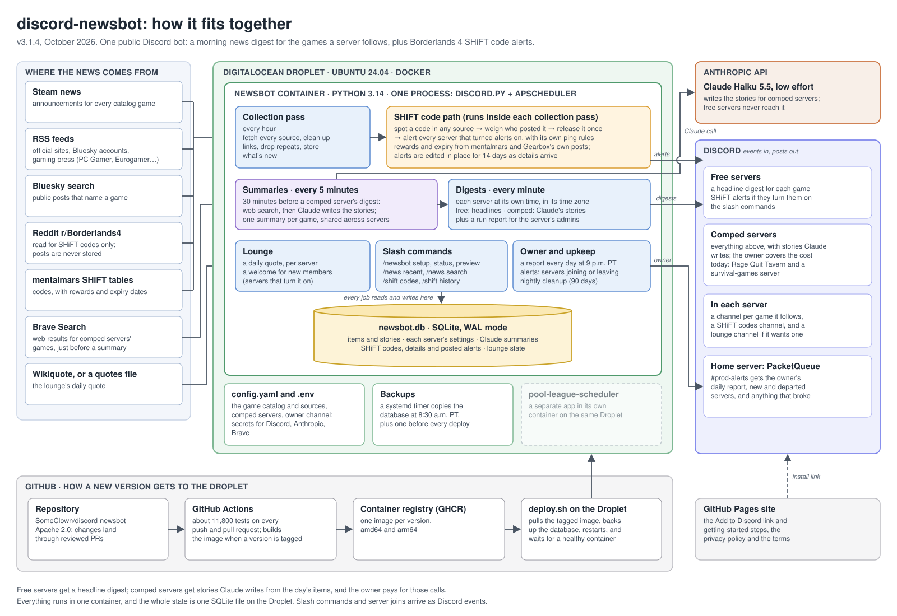

# discord-newsbot

A Discord bot that reads the internet every morning so your server doesn't
have to. Pick the games you follow from a catalog (Borderlands 4, Palworld,
Diablo IV, Fortnite, Call of Duty, Marvel Rivals, VALORANT, Counter-Strike 2,
Apex Legends, Rust, Destiny 2, Warframe, Final Fantasy XIV, Aniimo,
WARDOGS, ARC Raiders, Valheim, SCUM, DayZ, Active Matter and Escape
from Tarkov), and at the time you choose it posts a digest of the day's news for
each one, in the channel you pick. It can also announce new Borderlands SHiFT
codes, and members can ask it for recent news or search it on demand.

There's one more entry in the catalog, "Gaming industry", for news that isn't
about any one game: studios closing, layoffs, acquisitions, new games and
hardware announced. A server follows it like a game, in whatever channel you
give it (`/newsbot follow` gives it its own), and it posts at most 5 stories a
day.

It started as one bot for one ~50-person server and three games. Since v3.0
it's one bot that any server can install: the maintainer runs a public copy,
each server sets itself up with slash commands, and the sources are fetched
once an hour for everybody. If you'd rather run a copy of your own, that
still works and is [documented](#run-your-own-copy) below.

**Status.** The bot is public, and production runs v3.4.0 (since 2026-10-29).

## What's new

**v3.4.0 (2026-10-29), shorter links.** Digests, the Gaming industry post and
`/news` show each source as the site's name (`pcgamer.com`) instead of the
whole address, so posts read shorter on a phone. SHiFT alerts look the same.

**v3.3.1 (2026-10-24), a security release.**

- AI-written story text can't fake a second story or an OFFICIAL label any more.
- Feed text can't break out of the item list Claude reads.
- Discord invite and gift links are never stored or shown, in digests, `/news`
  or SHiFT alerts; SHiFT codes from such posts still post, without the link.

**v3.3.0 (2026-10-24)** added the optional "Gaming industry" entry: studios
closing, layoffs, acquisitions and announcements, at most 5 stories a day.

The rest, back to v1.1.0, is in [`CHANGELOG.md`](CHANGELOG.md).

## Add it to your server

[**Add to Discord**](https://discord.com/oauth2/authorize?client_id=1553075538220941402)
(you need the Manage Server permission in the server you pick). Then:

1. Run `/newsbot setup`. It asks for your time zone, the time you want the
   daily digest, the games you follow, and the channel to post in. Run it
   again any time to change your answers.
2. If you want Borderlands 4 SHiFT code alerts, run `/newsbot shift` to turn
   them on, pick their channel, and decide whether they ping a role,
   everyone, or nobody (nobody is the default).

Members then have `/news recent`, `/news search` and `/shift codes`. There's
nothing to build or host: the maintainer runs the bot, and your server just
uses it. The same steps are on the [project page](https://someclown.github.io/discord-newsbot/).

## Free and comped servers

Two tiers, and only one of them costs the maintainer money.

- **Free (every server):** a headline digest for each game you follow, plus
  SHiFT code alerts if you turn them on. No AI writes any of the text. (The
  one place a model has a hand is Gaming industry's story pick, below; even
  there, a free server only sees the source's own headlines.) The headlines come
  from the shared collection (official blogs, Steam announcements, Bluesky,
  gaming sites, and web search results), sorted official first, then
  press, then community. `/news recent` and `/news search` show those same
  stored headlines.
- **Comped (a few servers the maintainer covers on his own keys):** the same,
  except the digest is an AI-written summary (Claude), with stories labeled
  official, reported or rumor and linked to their sources. Web search only runs
  for games a comped server follows.

There is no paid tier yet. If you run your own copy, you decide which of your
servers are comped, with `comped_guild_ids` in your config.

## Run your own copy

Two documents cover this:

- **[`docs/finding-sources.md`](docs/finding-sources.md)**: recipes for
  finding Steam, Bluesky, subreddit, and press sources for your own
  game, plus the aliasing lessons (some words match more than you'd think)
  that came out of doing this for the games above.
- **[`docs/self-host.md`](docs/self-host.md)**: the actual setup guide:
  prerequisites, creating your own Discord application, keys and costs,
  `config.yaml` and `.env`, choosing an image, and the first run.

[`docs/deploy.md`](docs/deploy.md) is a different document: it's the maintainer's own
Droplet-specific runbook (see [Maintainer notes](#maintainer-notes) below),
useful as a worked example but not written for a general audience the way
the two documents above are.

## What a digest looks like

Each game you follow gets its own message in the channel you picked for it:
no combined channel, no header, no discussion thread. A game with nothing new
that day posts nothing at all. A free server's looks something like this
(illustrative only, not real scraped content):

> **Borderlands 4**
> • 🟢 OFFICIAL · Hotfix 5 now live — [borderlands.com](<https://borderlands.com>)
> • Datamined patch notes point to a new Vault Hunter — [pcgamer.com](<https://pcgamer.com>)
> • Mayhem 6 loot rates, explained by a very tired player — [bsky.app](<https://bsky.app>)

Each link shows the site's domain instead of the whole address (the full
address is still behind it), so a line stays short on a phone. A host that
isn't a plain name, like a raw IPv6 address, reads "link".

Official items get the marker and go first, then press, then community, then
newest. Nothing is labeled "rumor": a headline list makes no claim about
whether something is true, and calling every Reddit post a rumor would be
unkind to Reddit. When the list is too long for one message, whole lines are
dropped from the bottom and the last one says how many were cut and points at
`/news`.

A comped server's digest has the AI-written stories instead:

> 🟢 **OFFICIAL · Hotfix 5 now live**
> Fixes a crash on the Vault of the Traveler boss fight and adjusts loot drop
> rates on Mayhem 6+.
> [borderlands.com](<https://borderlands.com>) · [store.steampowered.com](<https://store.steampowered.com>)
>
> 🟡 **REPORTED · Datamined patch notes point to a new Vault Hunter**
> Several outlets are citing files pulled from the latest patch; nothing
> official yet.
> [pcgamer.com](<https://pcgamer.com>) · +2 more

Sorted official, then reported, then rumor, each labeled so nobody mistakes a
leak for a patch note. A coverage caveat ("Brave search skipped: quota
exceeded"), if there is one that day, rides along in that game's embed footer.

**Gaming industry** is the exception to "one message per game". It posts last,
after a server's games, and holds at most 5 stories however many the day had.
Once a day Claude reads what the four trade-press feeds collected (studio
closures, layoffs, acquisitions, new games and hardware announced, platform
and policy changes; not executive hires, earnings footnotes, job ads or
sponsored posts) and picks the stories that matter, most significant first.
Servers that post at the same time share one pick. A comped server gets it as summaries, in
the style above. A free server gets the same stories as a short list of the
source's own headlines and links, with no AI-written text and no rumor mark,
the same as any free headline list. A day with nothing worth posting posts
nothing.

## Commands

Everything below is server-only (no DMs). Until an admin has run
`/newsbot setup`, the member commands say so and do nothing else.

**Anyone:**

- **`/news recent game:<a followed game|All> days:<1-30, default 7> label:<official|reported|rumor, optional> public:<bool, default false>`**:
  recent news for a game this server follows (or all of them). On a free
  server it lists stored headlines, and `label` is ignored; on a comped
  server it lists stories, and `label` filters them.
- **`/news search query:<text> days:<1-30, default 30> public:<bool, default false>`**:
  full-text search over the headlines (free) or the story headlines and
  summaries (comped), limited to the games this server follows.
- **`/shift codes type:<all|golden|cosmetic|permanent, default all> public:<bool, default false>`**:
  the SHiFT codes that should still work right now, grouped as Golden Keys,
  Cosmetics, Permanent and Other, newest first. Each is a copyable code with
  its reward and when it expires, where the bot knows. A code counts as
  current until the end of its expiry date (Pacific time); with no known
  expiry, for 180 days after the bot first saw it; a permanent code always.
- **`/shift history days:<1-90, default 14> public:<bool, default false>`**:
  every SHiFT code the bot has seen within the window, current or not,
  newest first, each with a copyable code block, first-seen date, source link
  and details, and marked when it came from a roundup, is old, or has
  expired.

Both `/shift` commands are only for servers that follow a game SHiFT
detection covers (Borderlands 4 by default). Long lists page by size, so an
entry is never cut off.

Command results default to a private (ephemeral) reply; `public:true` shows
them to the whole channel. Multi-page results get Previous/Next buttons that
only the person who ran the command can use.

**Server admins (Manage Server, the `admin_permission` setting):**

- **`/newsbot setup`**: a guided first run, shown only to you. Pick a time
  zone, a digest time, up to 10 games (plus Gaming industry, which doesn't
  count toward the 10), and the channel for them, then Save. Run it again
  any time to edit.
- **`/newsbot follow game: channel:`** and **`unfollow game:`**: add, move or
  drop one game (with autocomplete), so each game can have its own channel.
  **`/newsbot games`** lists what you follow and the rest of the catalog; its
  "Following N of 10" count leaves Gaming industry out.
- **`/newsbot settings time: timezone: admin_channel: clear_admin_channel:`**:
  change the digest time (`HH:MM`), the time zone (any IANA zone, with
  autocomplete), and where this server's own run reports and problem notes go.
- **`/newsbot shift channel: enabled: ping: role:`**: SHiFT code alerts for
  this server: where they post, and whether they ping nobody (the default),
  `@everyone`, or a role. See [SHiFT code alerts](#shift-code-alerts).
- **`/newsbot status`**: this server's tier, digest time and next due time,
  the last digest with jump links, each followed game with how many of its
  sources are healthy, SHiFT settings and today's pings, and the newest problem
  notes. It never shows spend.
- **`/newsbot preview`**: builds the digest the server would get next and shows
  it only to you. Nothing is posted or saved. Once per server per 10 minutes.
- **`/newsbot run-now`**: posts the digest immediately. Asks for confirmation if
  today's already went out; a confirmed re-run reposts every game, and is
  also limited to once per server per 10 minutes.

Every admin command re-checks the permission on the server side, and the bot
refuses to manage a server it isn't actually in (an invite with only the
commands scope). The bot's owner is never held to the 10-minute limits.

**Owner only:**

- **`/owner servers`**: registered in the owner's home server alone. Counts
  only: servers, how many are set up, free and comped, today's digests by
  status, servers with SHiFT on or with permission problems, and the month's
  spend.
- **`/lounge quote-now`** (admin, in a server with a lounge): posts today's
  lounge quote now, and the scheduled one then skips today. Asks first if
  today's already went out. See [Lounge](#lounge).

## Run reports and problems

A server's own problems (a channel the bot can't post in, a digest that
failed) and its run reports go to that server and nobody else. If an admin set
a channel with `/newsbot settings admin_channel:`, they're posted there;
either way the newest few show up in `/newsbot status`. After each digest that
posts (`ok` or `partial`), the admin channel gets a one-message report:

> ✅ **Digest posted** · Sat Sep 27 (scheduled)
> 7 items: Borderlands 4 2 [jump] · Palworld 1 [jump] · Diablo IV 4 [jump]
> Took 1m52s

It lists what each game posted with a jump link, any game that was skipped
and why, and how long it took. It has no source health and no spend: that's
the owner's business, not a server's. A `partial` run (a game's channel
refused the post, or a summary fell back to headlines) swaps the emoji for ⚠️
("Digest posted with gaps") and adds a `Notes:` line. A game whose channel was
deleted or locked is skipped and reported, and the rest of the server's games
still post; the bot never picks a different channel on its own.
`/newsbot preview` never reports. Controlled by `run_report` (default `true`),
and only takes effect when the server has an admin channel.

The owner's channel gets something else entirely: bot-wide health only. A
source that failed 12 collections in a row (half a day), a crashed job, the
import notice, permission-problem counts, and one daily line like "digests
posted to 37 of 38 servers; 1 failed (missing permissions)". Server problems
never go there, and the owner's alerts never go to a server.

## Lounge

Optional, for one server only (v2.2, kept by v3): the one named by `guild_id`
in `config.yaml`. It's off unless the file has a `lounge:` block. Two things, both posted to one channel:

- **A welcome** for each new member, written by you in `config.yaml`, with
  `{member}` and `{server}` as the only placeholders. Bots are never
  welcomed, and nobody is welcomed twice in 24 hours. This needs the
  **Server Members Intent** switched on in the Developer Portal before the
  bot starts; without it the bot says so and exits after a 10-minute wait.
- **A daily quote**, fortune-cookie style, at a time you pick (default
  08:00 in the server's time zone). Quotes come from Wikiquote pages, a text
  file of your own, or a raw https link, mixed as you like. With no list
  configured it draws from a built-in one: Oscar Wilde, Mark Twain,
  Benjamin Franklin, William Shakespeare, Jane Austen, Edgar Allan Poe and
  Marcus Aurelius, all public-domain authors. Nothing repeats until a
  source's quotes have all been used. Modern copyrighted works are
  possible but carry real copyright risk, so they're commented-out examples
  in `config.example.yaml`, never a default.

There's no command to set a lounge up, and no other server can have one: the
settings are read from `config.yaml` into the database, and a `lounge:` block
left there is re-applied to them at every start.
Setup, source types and Docker paths are in
[`docs/self-host.md`](docs/self-host.md) §13; the design is
[`docs/design.md`](docs/design.md) §14.

## SHiFT code alerts

This is specifically for Borderlands-family games: it recognizes only
Gearbox's own SHiFT/Golden Key redeem code format
(`XXXXX-XXXXX-XXXXX-XXXXX-XXXXX`) and nothing else, so it has nothing to do
for any other game. It's opt-in per server for a reason covered below (an
`@everyone` ping is the one thing this bot does that's hard to take back):
alerts are off until an admin runs `/newsbot shift`, and the ping defaults to
**none**.

Detection is global and happens once per hourly collection pass: the bot
looks for codes in every source of the games listed under `shift: games:` in
`config.yaml` (default `borderlands4`), in each item's full text. Each new
code is then queued for every server with alerts on, and delivered to that
server's own channel with that server's own ping choice and daily cap. Turning
alerts on starts from codes found after that moment; there's no backlog.

Safeguards, since a ping is the one thing this bot can do that's hard to
take back:

- **Once per code, ever.** Every code seen is recorded in `alerted_codes`;
  a code already there never alerts again.
- **Silent seeding.** The first collection after the feature's marker is
  missing records whatever codes it finds without posting, so months of old
  codes already sitting in a feed don't flood anyone.
- **Age limit.** A code first seen only in an item older than
  `shift.max_item_age_hours` (default 48) is recorded but never posted.
- **Daily ping cap, per server.** At most `shift.max_pings_per_day` (default
  3) messages a day carry a ping, counted in that server's own local day;
  beyond that, codes still post, just unpinged, and the server is told.
- **Who can trigger a ping.** Every new code still posts, but only a code
  seen from a source whose trust is in `shift.ping_trust` (default:
  `official`, `press`) makes its batch carry the server's ping. A
  community-only code (a Reddit thread guessing at one, say) posts quietly.
  (Reddit is only read to spot codes; see "Reddit is codes only" below.)
- **A second source can earn the ping.** If a community-only code is then seen
  by a second, independent source (a different source name, compared without
  regard to case) or an official or press one within 24 hours of its first
  sighting, each server whose original post went out unpinged for that reason,
  and has pinging on, gets one follow-up headed
  `> confirmed by a second source ▌`, with its chosen ping. Each code sits in
  its own block, with its `reward` and `expires` line when it has details and
  no source line (the original post already named one). It spends one of that
  day's pings. A spent cap skips it silently; a server gets at most one per
  code, ever. A burst of confirmations shares that one ping: the first
  message pings, and whatever doesn't fit in it (a message holds about 15
  codes, about 4 with the longest possible details) follows in
  `> confirmed by a second source (continued) ▌` messages that don't. Two sources
  seeing a code in the same pass just ping on the first post. A confirmation
  that arrives while the original is still queued waits for the next sighting,
  and a stale second sighting still counts (the bot only asks that it *sees*
  the second source within 24 hours). Roundup sightings never confirm.
- **Roundups post, but without a ping.** An item naming more than
  `shift.max_codes_per_item` (default 5) distinct codes is a roundup or
  megathread, not a genuine single-code announcement. A fresh code whose
  only sightings are roundup items still posts under a separate
  `> SHiFT roundup ▌` header ("7 codes from" the source, then a link to its
  post), never pinged, and never spending the cap; capped at 50 fresh roundup codes per pass, with the rest recorded
  silently and the owner told.
- **A failed send keeps its ping only if nobody could have been pinged.** If
  Discord answers 429 (it refused the message), the retry keeps the ping,
  because nobody was notified. Any ambiguous failure (a timeout, a 5xx, a
  dropped connection) strips the ping from every later attempt, so at most
  one ping-bearing send could ever have landed.

`/newsbot status` shows the server's SHiFT settings and today's ping spend
against the cap. `/shift history` lists every code the bot knows about,
including roundup ones, marked as such; `/shift codes` is the shorter list of
the ones that should still work.

**Discord permission required:** the bot's role needs **View Channel** and
**Send Messages** in the SHiFT channel, plus **Mention @everyone, @here, and
All Roles** if the ping is `everyone` (or a role that isn't mentionable).
Without the mention permission, Discord still posts the alert message, it
just silently drops the notification; the bot checks before every ping,
posts anyway, and tells that server's admins. `/newsbot shift` also checks
what's missing the moment it's saved, and the bot checks every server's
channels once at startup, telling each server only when its problems change.

**What a code unlocks, and when it dies.** Since v3.1.0 an alert can say
more than the code. The details come from two places: Gearbox's own posts
(read only when they're plain, like "3 Golden Keys, expires October 14" on a
post with one code, and ignored when they're not) and
[mentalmars' Borderlands 4 SHiFT code tables](https://mentalmars.com/game-news/borderlands-4-shift-codes/),
a community page the bot reads once an hour as a `shift_table` source. That
page is used only for its tables of codes, rewards and expiry dates. It's
never stored as news, summarized or shown in a digest, and a code it finds
first posts without a ping like any other community find (it does count as the
second source that can earn the follow-up above). For each of reward, kind and
expiry, Gearbox's value beats mentalmars', and a missing value never erases a
known one. A code with details gets a line under it:
`` `reward` 3 Golden Keys · `expires` Oct 14, 2026 (in 3 days) · `via` mentalmars ``
(Discord draws the backticked words as small gray labels). The "in 3 days" is
a Discord timestamp, so Discord keeps it counting down and shows each reader
their own time zone. With nothing known, the line is left out.

Since v3.2.0 the whole alert has a terminal look: a `> new SHiFT code ▌` header
(a still cursor; Discord can't animate text), the code alone in its block so
the copy icon copies only the code, the details line, and a `src` line with the
source and its link. It's all plain text and small gray labels, so it reads the
same on a phone. `/shift codes` and `/shift history` keep their pages and
buttons, with a green stripe, `> current SHiFT codes ▌` and
`> SHiFT code history ▌` titles, and `[golden keys]`-style group headings.
Alerts posted before v3.2.0 keep their old layout when they're edited.

When details arrive after an alert has posted, the bot edits that message in
place (for 14 days after it posts; no new message, and no new notification).
It needs nothing beyond the permissions above. If an edit is refused, the
server's admins hear about it once, and edits to that server stop until
`/newsbot shift` is saved again. Alerts posted before v3.1.0 are never edited;
their details show in `/shift codes`.

Details are only as good as their sources. mentalmars is a community page,
not an official one, and it may be wrong or late. For your own copy, the source looks like this
(under the game, with `trust: community`; it's always codes-only):

```yaml
- {type: shift_table, name: "mentalmars", url: "https://mentalmars.com/game-news/borderlands-4-shift-codes/", trust: community}
```

## Architecture



The same picture as a one-page PDF, for anyone without the repo handy:
[`docs/architecture.pdf`](docs/architecture.pdf).

A single container runs a single Python process: one `discord.py` client
that also drives the jobs on an in-process `APScheduler` scheduler. The
work is plain functions with no Discord dependency, so it can run headless
from the CLI or be tested without a gateway connection at all; the bot is a
thin adapter on top of it. Three jobs do the real work:

- **Hourly collection** (`pipeline/collect.py`): fetch every catalog game's
  sources once, normalize, dedupe, filter by game, store the items, run
  SHiFT detection, and queue codes for each server.
- **Summaries every 5 minutes** (`pipeline/summaries.py`): make the comped
  servers' Claude summaries, and the Gaming industry pick, ahead of time,
  once per game per cycle, so a digest never waits on Claude.
- **Digests every minute** (`pipeline/guild_digest.py`, `guilds/schedule.py`):
  find the servers whose local digest time has passed with no digest for their
  day, then claim, render, post and save each one. Catch-up after downtime
  falls out of the same check.

```
newsbot/
  config.py        load + validate config.yaml and secrets (pydantic); derives a catalog from a v2 file
  collectors/       one module per source type -> list[RawItem]
    rss.py  steam.py  bluesky.py  web_search.py  shift_table.py
  pipeline/
    collect.py      the hourly shared collection, source health, SHiFT hook
    summaries.py    comped summaries, made once per game per cycle and reused
    guild_digest.py one server's digest: claim, render, publish (resumable), save
    normalize.py    URL canonicalization, dedupe vs. the store
    filter.py       keyword game matching, "uncertain" flag, dedicated sources
    summarize.py    Claude call, prompt assembly, schema validation, fallback
    run.py          the headless CLI entry point (check-sources, collect, dry-run)
    publisher.py    Publisher protocol (stdout for the CLI, Discord for the bot)
    lock.py         the collection pass's lock
  guilds/           per-server state (design.md §15)
    importer.py     the one-time import of a v2 single-server config
    schedule.py     pure: which servers are due, DST-safe, item windows
    lifecycle.py    pure: join, removal and startup reconciliation plans
    notify.py       who hears about what: owner channel vs. a server's own
  shift/            SHiFT code alerts (design.md §12, §15)
    match.py        pure code/Golden Key text matcher, no ReDoS surface
    decide.py       pure planner: what's new, fresh, worth a ping, worth seeding
    details.py      pure: which source's reward, expiry and category win, and the 180-day clock
    official.py     reads a reward and expiry out of Gearbox's own posts, or gives up
    fanout.py       release a code once, then deliver it per server
    edits.py        edit a posted alert in place when its code's details change
    sweep.py        the poster protocol and the retry-without-a-second-ping rule
  lounge/           welcomes and the daily quote (design.md §14), for one server
  store/
    migrations/     numbered .sql files (001 to 009)
    db.py           connection, WAL, migration runner (incl. foreign-keys-off rebuilds)
    repo.py         all queries (no SQL anywhere else)
  bot/
    client.py       discord client, scheduler wiring, heartbeat, lifecycle handlers
    commands.py     /news, /shift codes, /shift history, /newsbot, /lounge
    setup_views.py  the /newsbot setup wizard
    owner_commands.py  /owner servers
    registration.py which commands exist where, synced only when they changed
    format.py       digest + result embeds + code alerts, paging, UTF-16-aware limits
    permissions.py  per-server permission checks
  alerts.py         low-level channel sends
  healthcheck.py    Docker HEALTHCHECK entry point (checks the heartbeat file)
```

## Local development

Requires **Python 3.14** and plain `venv` + `pip`: no `uv`, no Poetry.
`requirements.txt` is the fully pinned lock file that Docker and CI install
from; regenerate it with `scripts/lock.sh` after changing the dependency
list in `pyproject.toml`, never by hand. Dependabot (`.github/dependabot.yml`)
proposes weekly PRs bumping individual pins in `requirements.txt` directly,
which is fine; it's the same kind of edit `lock.sh` makes, just one
dependency at a time; run `scripts/lock.sh` yourself afterward if you want
to also pick up transitive-dependency updates Dependabot doesn't touch.

```bash
python3.14 -m venv .venv
source .venv/bin/activate
pip install -r requirements-dev.txt
pip install -e . --no-deps
```

The gate (lint, format check, tests) that has to stay green:

```bash
ruff check . && ruff format --check . && pytest -q
```

The suite is about 7,900 tests and takes around three minutes. It never touches
the real network: every hostname resolves to a test address and any attempt to
open a real connection fails the test (a test that needs one is marked
`real_network`), so a slow DNS lookup can't masquerade as a hung test run.

Exercise the whole pipeline with no Discord and no network at all:

```bash
python -m newsbot.pipeline.run --dry-run --config tests/fixtures/config_v2_example.yaml \
  --db /tmp/nb.db --fixtures tests/fixtures/integration --stub-llm tests/fixtures/integration/llm.json \
  --now 2026-09-23T09:00:00+00:00
```

This runs against the pre-v3 single-server example (a v2-shaped config, kept
as a fixture) rather than `config.example.yaml`, because a dry run previews one
server's digest and the v3 example has no server in it; the file's server is
imported into the scratch database first. Its game keys (`borderlands4`, `palworld`) match the fixture items, and
`--now` pins the clock to the fixture data's own frozen date (2026-09-23) so
this stays deterministic no matter when you happen to run it: see
`docs/self-host.md` step 6 for why. Drop `--fixtures`/`--stub-llm`/`--now` to
hit real sources and Claude. `--check-sources [--game KEY]` runs the real
sources and reports per source with no database, Claude key or Discord token,
and that's how the source list and the summary prompt get tuned in practice;
see `docs/sources-research.md` for how the seed sources were verified.
`--dry-run` works on a throwaway copy of `--db`, so it can't write; but
`--collect`, `--fixtures` and `--post-to-stdout` do write, and none of them
belongs near a live database. The full list of modes is in
`docs/self-host.md` §14.

To see what the SHiFT alerts and `/shift` pages look like without a Discord
server, run `python scripts/preview_shift_look.py` (add `--screenshots` for
desktop and phone images; that part needs Chrome at its Mac path). It renders
every case through the real formatting code into
`build/shift-look/index.html`, imitating Discord's dark theme. It's an
approximation of Discord, not Discord.

### Running the dev bot

1. Copy `.env.example` to `.env.dev` and fill in a **dev** Discord bot token
   (a separate application from prod, never run two processes on the same
   token; they'll race each other and the loser logs `Unknown interaction
   (10062)`).
2. Copy `config.example.yaml` to `config.dev.yaml` and set `home_guild_id` and
   `owner_channel_id` to your private test guild, and `command_guild_ids` to
   the test guild (so commands show up instantly instead of taking up to an
   hour). Add `comped_guild_ids` to try AI summaries. Everything else is set
   from Discord with `/newsbot setup`.
3. Run directly:
   ```bash
   set -a && . ./.env.dev && set +a
   NEWSBOT_CONFIG=config.dev.yaml python -m newsbot
   ```
   or via Docker Compose, which builds the image locally instead of pulling
   from GHCR:
   ```bash
   docker compose -f docker-compose.yml -f docker-compose.dev.yml up --build
   ```

Never run `docker compose ... config` (or anything else that resolves
`env_file`) against the real `.env`/`.env.dev`; it prints every secret in
plain text to the terminal.

Any change to the summarization prompt needs an owner-reviewed
`/newsbot preview` before it merges; that's the whole point of the preview
command existing.

## Configuration

`config.yaml` (git-ignored; `config.example.yaml` is the committed template)
is mounted read-only into the container. Secrets live in `.env`, which is
also git-ignored. Since v3 it holds the bot's global settings and the game
catalog, and nothing about any one server: channels, digest times, time
zones and SHiFT settings live in the database and are set with `/newsbot`
commands.

Highlights of the schema: see `config.example.yaml` for a complete, real
example, and [`docs/design.md`](docs/design.md) (§3 for the original shape,
§15 for v3) for the spec:

- **`catalog`**: up to 25 games, each with a `key`, display `name`,
  `aliases`, `entities` (looser, "uncertain" matches), `search_queries` for
  that game's Brave News queries, `match_name` (false for names that are
  ordinary words, like Rust), and its own `sources`. No channels: those are
  per server. Keep Borderlands 4, Palworld and Diablo IV first and in that
  order, because the AI prompt lists a comped server's games in catalog order.
  The **Gaming industry** entry (`key: industry`) goes last, and it's picked
  out by that key, not by a flag. Its rules are checked at startup and a break
  stops the bot: `match_name: false`, no `aliases`, `entities` or
  `search_queries`, at least one source of its own, every one of them `type:
  rss` with `trust: press`, no shared source or `shift.games` entry naming it.
  Nothing else depends on the entry, so you can delete it. After that, each
  server that followed it gets an "industry: not in the catalog any more,
  skipped" note and a partial digest until an admin saves `/newsbot setup`
  again (`/newsbot unfollow` can't remove it).
- **`sources`** (under a game, or in **`shared_sources`** for feeds that cover
  many games): `rss`, `steam_news` and `bluesky_search` (plus `shift_table`,
  under a game only; see "SHiFT code alerts" below), each with a `trust`
  level (`official`, `press`, or `community`), which affects ordering and
  which items survive the per-game cap. A source listed under a game is a
  *dedicated source*: every item it returns is a confident match for that
  game even if the text never names it, which is how a Steam post titled
  "v0.6.2 Update" still reaches Palworld's digest. A shared source is
  keyword-matched against every game (or just the ones in its `games:`).
- **`web_search`**: Brave News, once a day, for games a comped server follows.
- **`shift`**, **`collection`**, **`ai`**, **`owner_report`**: SHiFT
  detection, the hourly pass, the summarizer's subject, and the owner's daily
  report. All have working defaults.
- **`home_guild_id`**, **`owner_channel_id`**: the owner's server and the
  channel in it for bot-wide alerts. **`comped_guild_ids`**: servers that get AI
  summaries. **`command_guild_ids`**: copy the commands into just these
  servers (instant, for dev and self-hosting) instead of registering them
  globally (up to an hour to show a change).
- **The single-server keys** (`guild_id`, `digest`, `topics` with a
  `channel_id`, `alerts`, `lounge`): only the lounge needs them, since it has
  no command. See the last block of `config.example.yaml` and
  `docs/self-host.md` §13.
- **Secrets** (`.env`): `DISCORD_TOKEN`, `ANTHROPIC_API_KEY`, `BRAVE_API_KEY`,
  and optionally `BLUESKY_HANDLE` / `BLUESKY_APP_PASSWORD` for authenticated
  Bluesky search (see Limitations below).

## Costs

Rough running cost against `config.example.yaml`'s source list, for one
comped server following three games:

- **Claude (Haiku 5.5, low effort)**: about 3 summarization calls per day
  (one per game with items), well **under a cent per day**: about a seventh
  of what Haiku 4.5 cost on the same news (measured 2026-10-22). Summaries are made once per
  game per cycle and shared, so a second comped server on the same schedule
  costs next to nothing extra; servers on different schedules get their own.
  Free servers cost nothing here, with one exception below.
- **Claude, Gaming industry**: one Haiku call per digest time that servers
  share (they share one pick), made only by the 5-minute summaries job, never
  more than one call per pass. That's a handful of calls a day, a few cents at
  most; the hard ceiling is 288 a day, well under a dollar at current prices.
  It's made for free servers too, since they get the pick's stories as
  headlines, so this cost is there even if no server is comped. A free
  server's digest, `/newsbot preview` and run-now never call a model: they
  show the stored pick, or the newest headlines if there isn't one.
- **Brave Search**: 2 queries per game per day, only for games a comped server
  follows, so about **6 requests a day** and roughly **180 a month** for
  three games (comfortably inside Brave's free tier). It doesn't grow with the
  number of servers, and there's no local monthly budget guard on it yet.
- **Collection and SHiFT**: no Claude or Brave cost at all. The hourly pass
  makes one `GET` per RSS/Steam/Bluesky source, whichever servers follow them
  (these are requests to each source's own site, not to Discord's API) and, on
  Bluesky, a login per pass. Reddit feeds are spaced 35 seconds apart, which
  matters only if you configure several (the example has one).

## Limitations and known issues

- **Gaming industry is trade press only.** Four feeds feed it (GamesIndustry.biz,
  Game Developer, VGC's news category and Gematsu's industry feed) and nothing
  else: no search, no keyword pulls from the general
  press, no Reddit. A story that none of them runs doesn't appear, and the
  trade press is sometimes a day behind the consumer outlets on a reported
  story. Rumors from those outlets are allowed and keep their label on a
  comped server. The pick is the model's judgment, so it can include a story
  you'd have skipped; the prompt was checked against a real day's news before
  release, not against every day's.
- **Reddit is codes only.** Reddit denied this bot's Data API access request
  (2026-10-04) and its Responsible Builder Policy bars sharing Reddit content,
  so the one subreddit in the example, r/Borderlands4, is read only to spot
  SHiFT codes (`codes_only: true`). Its posts are never stored, so they can't
  show up in a digest, a summary, `/news`, or the AI's input. Any source on
  reddit.com is treated that way, and one for a game that isn't in
  `shift.games` is skipped with a warning. A code alert can still link to the
  post it came from.
- **Reddit may block datacenter IPs.** The subreddit source was verified
  from a residential connection; Reddit rate-limits aggressively even there,
  and may reject requests outright from a hosting provider's IP range in
  production. If it happens, it shows up in `/newsbot status` ("N of M sources
  ok") and in the owner's alerts as a source health failure, not a crash.
- **YouTube channel feeds are out, for now.** They're plain RSS reads
  (`youtube.com/feeds/videos.xml?channel_id=...`) with no official
  guarantee of stability, and in late September 2026 every one of them
  started returning 404, so the example config no longer includes any.
- **Running `/newsbot run-now` a second time after today's digest already
  posted usually produces a mostly empty digest.** The window starts where
  the last digest ended, so there's little new, and the model is told to mark
  stories that add nothing new as `relevant: false`. A confirmed re-run does
  repost every game.
- **Bluesky search needs an app password.** Unauthenticated
  `bluesky_search` requests currently get a 403 with an HTML body (not even
  a JSON error) from Bluesky's public API. Without `BLUESKY_HANDLE` and
  `BLUESKY_APP_PASSWORD` set, those sources are skipped with a coverage
  note, not treated as a failure. The official-account RSS feeds work
  regardless: no auth needed for those.
- **Free headlines include web search results.** Brave's results are stored
  for everyone, so a free server's headlines can include them even though only
  comped servers cause the search to run. Left that way on purpose.
- **A big SHiFT drop drains slowly at hundreds of servers.** Delivery runs
  inside the collection pass's 120-second budget, so at about 170 or more
  SHiFT-enabled servers a code drop finishes over several hourly passes. If
  the bot ever gets that big, delivery should move into a job of its own.
- **A SHiFT alert holds fewer codes per message than it used to.** Room for
  the details line is set aside under every code so that a later edit always
  fits in Discord's 2,000-character limit, and nothing is ever cut short. With
  the example catalog a message holds about 4 codes where it used to hold
  about 18; a big drop just posts as more messages, and only the first one
  pings.
- **SHiFT code alerts can miss or delay a code.** Reddit's `/top?t=day`
  sort can take a while to surface a brand new post, so a code posted to a
  subreddit first might not alert until it's climbed the day's top posts
  (or shown up on an official feed instead). A code embedded only in an
  image (a screenshot, a stream overlay) is invisible to this; the
  matcher only reads text. Gearbox mostly posts codes on X, which isn't a
  source. A code split across an en dash or similar look-alike dash
  instead of a plain hyphen won't match the pattern (deliberately, see
  [`docs/design.md` §12](docs/design.md#12-shift-code-alerts-v12-approved-2026-09-25)'s clarifications on the regex). A code with no
  digits anywhere in its 25 characters won't be detected either: real
  SHiFT codes are virtually always a mix of letters and digits, and
  requiring at least one is what keeps an all-letter URL slug
  (`.../shift-codes-early-today-guide/`) or placeholder example
  (`AAAAA-BBBBB-CCCCC-DDDDD-EEEEE`) from matching as if it were a real
  code. Likewise, a code sitting directly against a `/` (a bare URL path
  segment, as opposed to a `?code=...` query value) won't match; see
  [`docs/design.md` §12](docs/design.md#12-shift-code-alerts-v12-approved-2026-09-25)'s clarifications for both rules.

## Safety notes

- Scraped text is **untrusted data**. It's sent to Claude clearly delimited
  as such, and any instructions embedded in it are ignored by prompt design.
- Every link posted to Discord comes only from the URLs actually collected
  from sources; the model can't introduce a new URL, and any URL the model
  invents that wasn't in its input is discarded before the digest is
  rendered.
- Any URL text that shows up inside a model-written headline or summary is
  stripped before rendering, so scraped or generated text can't grow a fake
  markdown link next to a real one.
- Every send is `allowed_mentions=none`: scraped text can't ping
  `@everyone`, a role, or a user, **except** a SHiFT code alert (or its
  "confirmed" follow-up), which is the one deliberate exception: it's allowed
  to ping `@everyone` or a role, and only when the alert pipeline itself (not
  scraped text) has decided to, from that server's own setting. The
  `@everyone` case is a fixed module constant used in exactly one place,
  pinned by a test that scans `newsbot/`'s source for any other
  `AllowedMentions(everyone=True, ...)` call; see
  [`docs/design.md` §12](docs/design.md#12-shift-code-alerts-v12-approved-2026-09-25) and `newsbot/bot/client.py`.
- A server's data is its own. Every query takes the server's id from the
  interaction, never from an option; a channel from another server is refused
  when it's written and again when it's posted to; autocomplete values are
  validated on the server side. When the bot is removed from a server, that
  server's rows are deleted.

## Maintainer notes

This section is about running *this* deployment (the maintainer's own
Droplet), not a general "how to self-host" guide. If you're setting up
your own copy, [Run your own copy](#run-your-own-copy) above is the right
starting point instead.

### Releasing

The standard path from a change to a running production bot:

1. **Feature branch, PR.** CI (`.github/workflows/ci.yml`) runs the gate
   (lint, format check, tests) on every push and PR.
2. **Merge to `main`.** CI publishes `ghcr.io/someclown/discord-newsbot:latest`
   and a `sha-<short>` tag for that specific build. GitHub Pages publishes
   `site/` (the privacy policy and terms) from `main` too.
3. **Build and check the image locally** from the merged `main`, before
   tagging. Docker Desktop doesn't run all the time (it wants 2 to 4 GB of
   memory, and once a forgotten dev container ran for 33 hours), so start
   it, build, check, and quit it again:
   ```bash
   open -a Docker            # then wait until `docker info` answers
   docker build -t newsbot-local .
   docker run --rm --entrypoint python newsbot-local -c "import newsbot"
   docker run --rm --entrypoint sh newsbot-local -c "ls /app/LICENSE /app/NOTICE"
   docker ps                 # should be empty
   osascript -e 'quit app "Docker Desktop"'
   ```
   A prompt change gets an owner-run `/newsbot preview` (or the CLI's
   `--dry-run`) on top of that. For anything else that needs a live
   Discord check, the staging overlay can still run the published image
   against the test guild with the dev bot:
   ```bash
   docker compose -f docker-compose.yml -f docker-compose.staging.yml pull
   docker compose -f docker-compose.yml -f docker-compose.staging.yml up -d
   ```
   `docker-compose.staging.yml` is the same dev token/config/database as
   `docker-compose.dev.yml` (`.env.dev`, `config.dev.yaml`, `data/dev.db`)
   but pulls the GHCR image instead of building locally, so it exercises
   the exact artifact that would get deployed. Stop `docker-compose.dev.yml`
   (or a local `python -m newsbot` against `.env.dev`) first; it's still
   the dev token, so it's still one-instance-per-token (see `CLAUDE.md`).
   It's unrelated to prod's token, so prod keeps running regardless. Every
   release since the bot went public has done the local check and skipped
   this one; it's here for the day a change can't be judged any other way.
4. **Tag a release** on the merge commit, as an annotated tag:
   ```bash
   git tag -a v3.2.1 -m "v3.2.1: what ships"
   git push origin v3.2.1
   ```
   CI additionally publishes semver tags (`3.2.1`, `3.2`) for a tagged
   push. That build makes the image for amd64 and arm64 and takes about
   15 minutes; wait for it to go green before deploying (see
   [`docs/deploy.md`](docs/deploy.md) §7).
   The tag goes on the merge commit, so the PR you merged in step 2 has to
   carry the release's docs already: `CHANGELOG.md`'s `[Unreleased]` entries
   moved into a new `[X.Y.Z] - date` section (with its link at the bottom), and
   this README's "What's new" refreshed. Once the tag is pushed, publish that
   version's section as a GitHub Release:
   ```bash
   gh release create v3.2.1 --verify-tag --title "v3.2.1" --notes-file <that section, saved to a file>
   ```
5. **Deploy** with `./scripts/deploy.sh` on the Droplet: see
   [`docs/deploy.md`](docs/deploy.md). Pin `TAG=3.2.1` in the Droplet's
   `.env` for a deliberate upgrade; rolling back is changing `TAG` back
   to the previous value.

### The Droplet

See [`docs/deploy.md`](docs/deploy.md) for the Droplet runbook (install,
secrets, rollback, backups, log viewing). It's written for that specific
server, but doubles as a worked example of most of what
[`docs/self-host.md`](docs/self-host.md) describes in general terms.

## License

Apache License 2.0; see [LICENSE](LICENSE) and [NOTICE](NOTICE). Short
version: do what you like with it, including selling it, but keep the NOTICE
file with anything you hand on, mark what you changed, and don't blame me when
a feed changes its format. Versions up to v3.0.5 went out under the MIT
License, and anyone who has one of those can keep using it on MIT terms.
